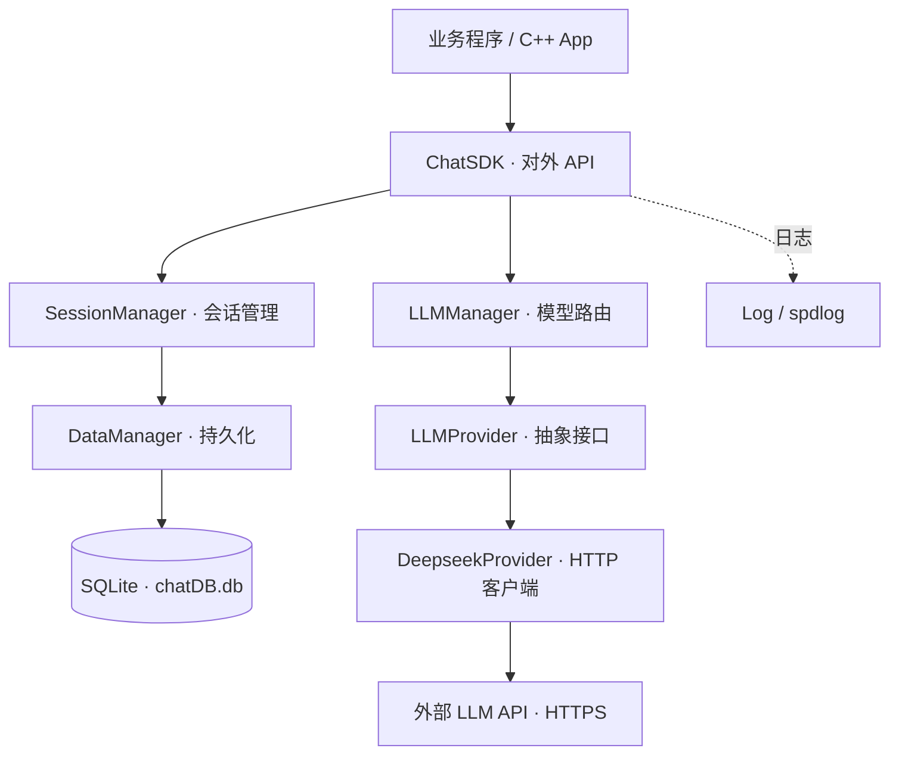

# LLM-SDK

> C++17 · CMake · SQLite · DeepSeek Provider · Streaming

一个轻量的 **C++ 大语言模型 SDK**，提供模型调用封装、会话生命周期管理、消息持久化和流式回调。采用 Provider 接口分离具体模型实现，适合作为 C++ AI 应用的基础组件或学习项目。

**仓库状态：** 当前版本仅包含 `LLM-access/sdk/` 下的 SDK 核心。旧文档曾提及的 `ChatServer/`、`SDKDemo/` 和 Web 界面并未提交到本仓库，因而**不属于当前可构建的交付内容**。这里不宣称提供 REST API 或 Web UI。

## ✨ 已实现的功能

| 模块 | 作用 |
| --- | --- |
| `ChatSDK` | SDK 初始化、创建/删除会话、同步与流式发送消息 |
| `SessionManager` | 会话和历史消息管理 |
| `DataManager` | 将会话与消息持久化至 SQLite |
| `LLMManager` | 模型注册和 Provider 路由 |
| `LLMProvider` | 可扩展的抽象 Provider 接口 |
| `DeepseekProvider` | 基于 cpp-httplib 的 HTTPS 请求、流式响应处理 |
| `Log` | 基于 spdlog 的日志工具 |

> **当前限制：** 模型注册逻辑中仍使用 `deepseek-v4-flash` / `deepseek-v4-pro` 等硬编码名称，且 Provider 的请求模型名并未完全参数化。它们是现有代码中的标识，**不代表官方 API 一定支持这些模型 ID**。接入实际服务前，请先核对服务端模型 ID、端点与流式/非流式路径。此仓库不是已经完成兼容性验证的通用 OpenAI SDK。

## 🗺️ 架构




## 📁 项目结构

```text
LLM-SDK/
├── .github/workflows/build.yml    # Ubuntu 构建检查
├── .editorconfig                  # 编辑器基础规范
├── .gitignore                     # 忽略构建产物、日志及本地数据
├── LICENSE                        # MIT
├── README.md
├── docs/
│   └── architecture.drawio        # 可拖动节点的源架构图
└── LLM-access/
    └── sdk/
        ├── CMakeLists.txt         # 核心静态库构建配置
        ├── include/               # 公开头文件
        │   ├── ChatSDK.h
        │   ├── DataManager.h
        │   ├── DeepseekProvider.h
        │   ├── LLMManager.h
        │   ├── LLMProvider.h
        │   ├── SessionManager.h
        │   ├── common.h
        │   └── util/Log.h
        └── src/                   # C++ 实现
            ├── ChatSDK.cpp
            ├── DataManager.cpp
            ├── DeepSeekProvider.cpp
            ├── LLMManager.cpp
            ├── SessionManager.cpp
            └── util/Log.cpp
```

**不提交 `build/`**：CMake 缓存、`.o`、`.a` 和中间文件会在本地或 CI 上自动生成。如果需要发布预编译库，请使用 GitHub Releases。

## 🚀 编译 SDK

### 依赖

建议使用 **Ubuntu 24.04（或兼容的 Debian 系统）**。依赖为 C++17、CMake ≥ 3.16，以及以下开发包：

| 依赖 | 用途 |
| --- | --- |
| OpenSSL | HTTPS / TLS |
| SQLite3 | 会话与消息存储 |
| spdlog（及其 fmt 依赖） | 日志 |
| jsoncpp | 请求/响应 JSON |
| cpp-httplib | HTTP 客户端 |
| pkg-config | 查找 jsoncpp / cpp-httplib |

```bash
sudo apt-get update
sudo apt-get install -y build-essential cmake pkg-config \
    libssl-dev libsqlite3-dev libspdlog-dev \
    libjsoncpp-dev libcpp-httplib-dev
```

### 构建

```bash
git clone https://github.com/fengjunziya/LLM-SDK.git
cd LLM-SDK

# 在仓库根目录创建独立的构建目录
cmake -S LLM-access/sdk -B build -DCMAKE_BUILD_TYPE=Release
cmake --build build --parallel
```

编译产物：`build/libai_chat_sdk.a`。本项目**没有独立的主程序可直接运行**；需要在自己的 C++ 程序中链接该静态库及相应依赖。

如需安装头文件和库（可选）：

```bash
sudo cmake --install build
```

## 💬 C++ 调用示例

下面演示当前 SDK 的调用接口。**实际请求是否成功取决于服务端是否支持源码中使用的模型标识及 API 路径**；示例不代表已经完成线上 API 连通测试。

```cpp
#include "ChatSDK.h"
#include "util/Log.h"
#include <cstdlib>
#include <iostream>
#include <memory>
#include <vector>

int main() {
    const char* key = std::getenv("DEEPSEEK_API_KEY");
    if (!key) {
        std::cerr << "Please set DEEPSEEK_API_KEY\n";
        return 1;
    }

    chat_sdk::Log::init("llm-sdk-example", "stdout");

    auto config = std::make_shared<chat_sdk::APIConfig>();
    config->_model_provider = "deepseek";
    config->_model_name = "deepseek-v4-flash"; // 当前源码中的模型标识
    config->_endpoint = "https://api.deepseek.com";
    config->_api_key = key;
    config->_max_tokens = 1024;
    config->_temperature = 0.7;

    chat_sdk::ChatSDK sdk;
    sdk.initModels({config});

    const auto sessionId = sdk.createSession(config->_model_name);
    if (sessionId.empty()) return 1;

    const auto response = sdk.sendMessage(sessionId, "你好！");
    std::cout << response << std::endl;
    return 0;
}
```

使用环境变量传入 API Key，不要把真实密钥写入源文件、提交记录或日志。

主要 API：

```cpp
bool initModels(const std::vector<std::shared_ptr<APIConfig>>& apiConfigs);
std::string createSession(const std::string& modelName);
std::string sendMessage(const std::string& sessionId, const std::string& message);
std::string sendMessageWithStream(const std::string& sessionId,
                                  const std::string& message,
                                  std::function<void(const std::string&, bool)> callback);
std::vector<Message> getHistoryMessages(const std::string& sessionId);
std::vector<std::string> getSessionLists() const;
bool deleteSession(const std::string& sessionId);
```

流式回调中的 `bool` 表示流结束状态；当前实现还需要结合服务端 SSE 规范核对兼容性。

## 🧩 扩展 Provider

`LLMProvider` 定义初始化、可用性查询、普通请求、流式请求等虚接口。新模型接入可以参考 `DeepseekProvider` 实现；当前还需要在 `ChatSDK::registerProviders()` / `initProviders()` 里增加注册及配置逻辑，尚不是运行时完全动态的插件系统。

## 🛠️ 开发与维护

- 统一使用 C++17 和 CMake；源文件保留在 `include/`、`src/` 中。
- 不提交任何 `build/`、二进制目标文件、SQLite 数据、日志或密钥。
- 提交代码前在干净环境执行 `cmake -S ...` 和 `cmake --build ...`。
- GitHub Actions 会在 push / Pull Request 时检查 Ubuntu 构建。
- 架构调整请同步修改 [draw.io 源图](docs/architecture.drawio) 与上方 Mermaid 图。

## 📄 License

[MIT License](LICENSE) · © 2026 fengjunziya
